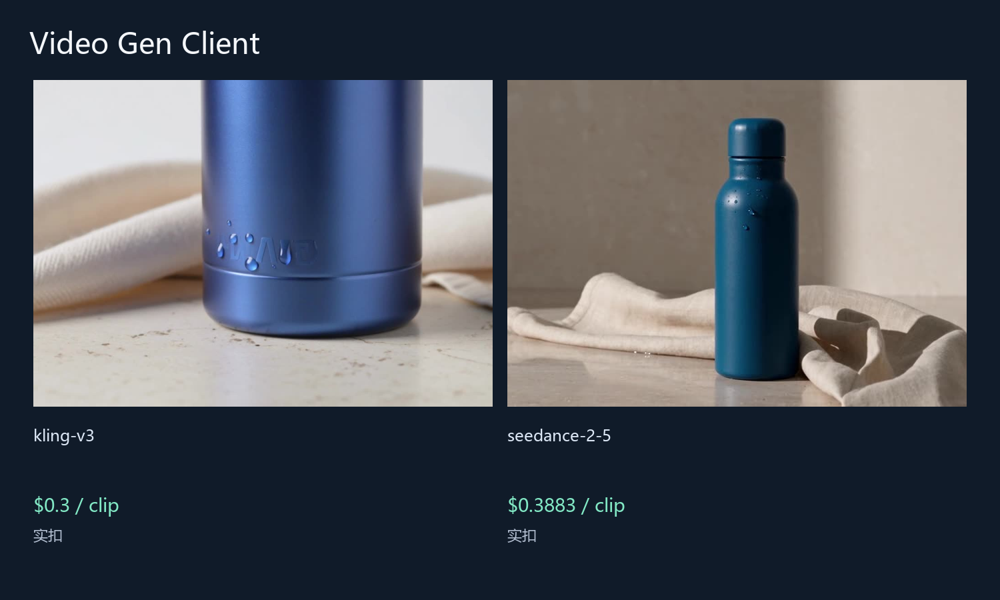
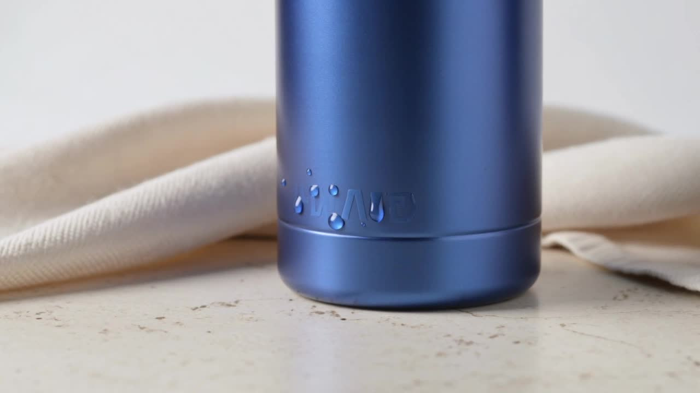

# 更低成本的 Video Gen Client 图片与视频方案

[English](README.md) | 中文

用一个 Python 客户端调用多个视频模型.

原生可选 Provider：Seedance 2.5 与 Kling v3 两条 SDK 真实生成、等待及下载成功；20 项测试通过，同 run ID 复用同任务。仅限已审查的文生视频预设，画面输入、浏览器 UI、取消和退款未验收。

Upstream: [letorig/video-generator-client](https://github.com/letorig/video-generator-client) · fixed SHA `2c5761773f2b799d3280fe2ecc839819d7bd4423` · MIT. Community work by ToAPIs; no upstream endorsement or partnership is implied. Existing sponsors and referral links are unchanged. “Lower-cost” describes the priced ToAPIs route, not a measured savings claim against every upstream supplier.

## 演示



### kling-v3 — $0.3 实扣

[](assets/kling-v3-native.mp4)

[MP4 — 5.04s](assets/kling-v3-native.mp4)

```json
{
  "model": "kling-v3",
  "duration": 5,
  "mode": "std",
  "aspect_ratio": "16:9",
  "audio": false
}
```

### seedance-2-5 — $0.3883 实扣

[](assets/seedance-2-5-native.mp4)

[MP4 — 4.04s](assets/seedance-2-5-native.mp4)

```json
{
  "model": "seedance-2-5",
  "duration": 4,
  "resolution": "480p",
  "aspect_ratio": "16:9",
  "generate_audio": false,
  "output_format": "mp4"
}
```

## API pricing

| Model / 模型 | Preset / 参数 | API pricing | Case / 本次案例 |
|---|---|---|---|
| kling-v3 | duration=5, mode=std, aspect_ratio=16:9, audio=False | $0.06/s | $0.3 actual; 5.04s; $0.059524/s observed |
| seedance-2-5 | duration=4, resolution=480p, aspect_ratio=16:9, generate_audio=False, output_format=mp4 | $1/M tokens | $0.3883 actual; 4.04s; $0.096114/s observed |

Token-metered rates use actual tokens; the observed $/s is this case’s settled cost divided by decoded MP4 duration, not a fixed future rate. Quotes are same-Key prices dated 2026-10-22, not confirmed charges. The client rechecks pricing before a paid submission.

## Run / 运行

No dependencies for the standalone client. Set `TOAPIS_API_KEY` privately. Base URL is `https://toapis.com` (without `/v1`); the client adds `/v1`.

```sh
python unified_client.py --model seedance-2-5 --prompt-file prompts/video.txt --max-usd .80
# quote only; explicitly add --live to submit a paid job
python unified_client.py --model seedance-2-5 --prompt-file prompts/video.txt --max-usd .80 --live --run-id my-reviewed-case
```

Same request + same run ID resumes the existing task. If a POST response is uncertain and has no ID, stop and reconcile; do not issue a replacement POST. Polling: `GET /v1/images/generations/{id}` or `/v1/videos/generations/{id}`; result: `result.data[0].url`; Bearer auth applies only to the API, not result downloads. Read settled `billing.cost_usd` and `billing.credits`; missing final billing stays unknown. Public case records exclude task IDs, credentials and account data.

[Integration details / 接入边界](integration/README.md) · [Original image prompt](prompts/image.txt) · [Video prompt](prompts/video.txt) · [Sanitized cases](cases.json)

Native SDK setup and reviewed presets: [ToAPIs provider](../docs/TOAPIS.md). This guide lives under `toapis-guide/`; original project source, license and README are retained at repository root.

[Model pricing & signup / 模型价表及注册](https://go25.toapis.com/1022_vg) · Campaign: `1022_vg`
